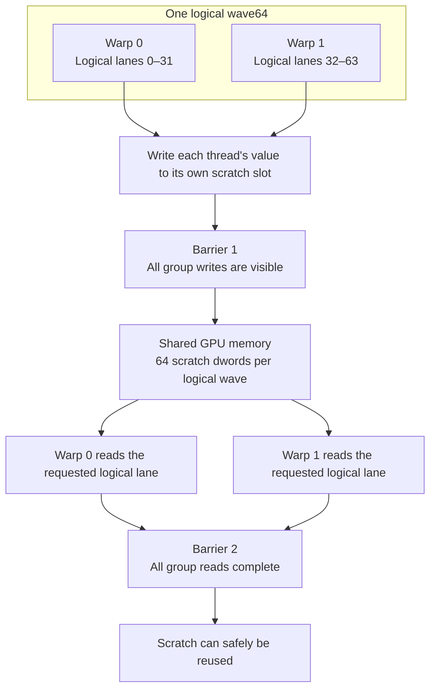
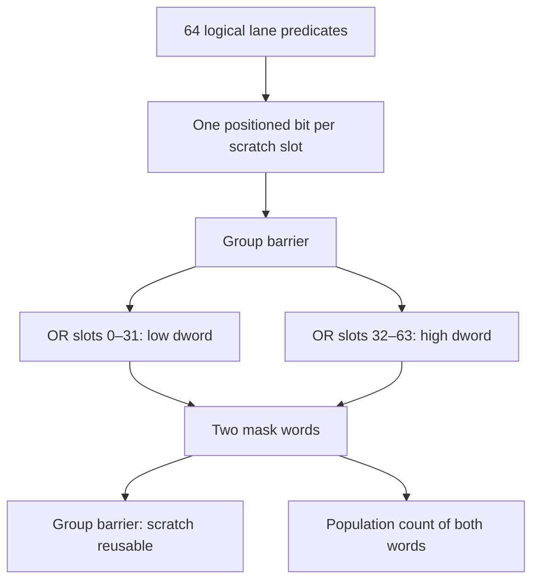
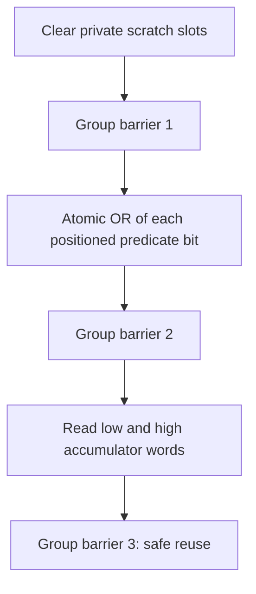

# VIctory

Runs Grand Theft Auto VI (Xbox Series X|S) natively on Windows, from files
the user supplies.

The title's x86-64 code runs unchanged inside our process; VIctory supplies
the platform underneath it and converts the title's data, ahead of time where
it can (shaders and pipelines too, see Getting started) and on first use
otherwise. See [docs/architecture.md](docs/architecture.md).

## Status (2026-11-24)

**Not playable yet.** The title boots, runs its menus at its own 30 fps,
loads the world and shows it: slowly, and with rendering defects.

| Stage | State |
|-------|-------|
| Boot, first-boot screens (accessibility, language, settings, legal) | works, 30 fps |
| Intro video with sound | works |
| Start screen, profile and saves | works |
| Loading into the world (about 50 s) | works |
| The world (first mission's intro) | drawn and shown: streets, buildings, vehicles, characters, the title card and credits; 1-2 s per frame. Surfaces are unlit, a band of distant geometry is missing, characters come out broken in some shots |

Tested on one machine: Windows 11, AMD RX 6700 XT.

> **Warning.** Entering the world on a real GPU has hung it in earlier
> builds, and Windows then resets the display driver (every monitor goes
> black for a moment). The latest runs did not, but it is not ruled out; a
> run can also end on a GPU fault (`crashes.log`). A diagnostics build with
> `VICTORY_D3D12_WARP=1` renders on the software adapter instead (too slow
> to reach the world in minutes).

What each part does today and what it still needs:

| Subsystem | Today | Needs |
|-----------|-------|-------|
| Loader | Runs the title's executable and its DLLs in our process; crash reports name the faulting code and are kept in `crashes.log` | – |
| Runtime services | One signed-in offline user, licences, packages, saves that survive a kill at any step, text entry dialog | Speech is silent; the dialog and relaunch are untested live |
| Network | Offline by design: the title cannot reach the network | – |
| Files and streaming | Archives and streamed data read, zlib and BCPack decoded in parallel | Loading is limited by writes into title memory |
| Input | XInput pads, keyboard, keyboard stand-in pad | Trigger rumble |
| Audio | Menu, video and loading sound; XMA voices and Opus streams decode | Reverb is silent; Opus results unverified against the title |
| GPU: menus | Draws, compute and presentation on host D3D12; only changed title memory is copied | Frame pacing drifts on one screen in release builds |
| GPU: world | The scene is drawn and presented: mesh pipelines, indirect execution, views the shaders pick from the heap themselves, title memory read by address (ray-tracing structures), depth written from compute, pipelines pre-built or made by worker threads and kept on disk | Lighting (surfaces are unlit) and some missing geometry; frames take 1-2 s; draws of untranslated shaders are dropped; real queries, depth bounds, HDR and scaling are missing |
| Shaders | Console GPU code recompiled to DXIL, ahead of time (`translate --cache`) or at first use, cached on disk. Menus: all. World: mesh 8,765 of 8,765, vertex/pixel 12,550 of 12,592, compute 2,579 of 2,637 | Merged geometry stages (195 programs) and about 100 others; fused multiply-adds follow the host GPU; some compute programs need a GPU with 64-lane waves |
| Textures | Console tiled layouts and detiling for the modes the title uses | Render-target metadata planes |
| Series S mode | Runs through the menus to the loading screen | The world, as above |

## NVIDIA compatibility progress (2026-11-25)

**100% of the five original regression failures resolved (5/5).** This is
a test-fix milestone, not a percentage of game compatibility or playability.

`[██████████] 100%`

Development branch: [fix/nvidia-compatibility](https://github.com/caeragasv3893-prog/VIctory/tree/fix/nvidia-compatibility).
Test machine: Windows, NVIDIA GeForce RTX 5060 Ti (8 GB), driver 610.88.

| Milestone | Progress | Status |
|-----------|----------|--------|
| Descriptor heap capacity | 100% | Regression passed with the experimental 1,000,000-descriptor limit |
| Dynamic descriptor slots | 100% | Regression passed |
| Null buffer descriptors | 100% | Regression passed |
| Texture gather | 100% | Targeted gather tests passed after matching structured SRV loads to their descriptors |
| Runtime-selected buffer stride | 100% | Workspace regression run reported passing with raw companion SRVs; original structured view retained |

### Test results

| Test suite | Baseline (passed / failed / ignored) | Latest confirmed result |
|------------|--------------------------------------|-------------------------|
| `victory-gpu` | 141 / 2 / 2 | Passed in latest workspace run; previously 143 / 0 / 2 after heap-limit change |
| `victory-shader` | 244 / 3 / 3 | Passed in latest workspace run |
| Full workspace | Initially stopped on GPU regressions | Passed (reported by the NVIDIA tester on 2026-11-25) |
| Release build | Initial build succeeded | Updated release build succeeded in 24.38 s (Windows, 2026-11-25) |

The NVIDIA tester reports that `cargo test --workspace --locked -- --test-threads=1`
completed successfully after the raw companion SRV changes. Exact final test
counts have not been supplied; no new totals are claimed. The updated release
build (`cargo build --release -p victory --locked`) succeeded in 24.38 seconds.
Title execution has not yet been validated. The one-million-descriptor limit is experimental: title
descriptors beyond the host capacity still need a correct mapping strategy.
Raw companion descriptors consume additional heap slots; their lifetime,
capacity, and behaviour during real workloads need validation. The new
companion path covers SRV reads, not all UAV writes or typed buffer accesses.

### Phase 2 — graphics runtime hardening (historical baseline)

**Phase 2 regression run: 705 passed, 0 failed, 11 ignored.** Windows release
build succeeded in 17.71 s. These results apply to commit `3856c93`, before
the subsequent Clippy-only type alias change. The nested HLE child test is
not counted twice. The type-complexity lint was resolved with a named
handle-cache key. Both strict Clippy checks passed on revision `f76c2b9`:
standard features in 6.49 s and all features in 6.77 s.

| Work item | Implementation | Validation |
|-----------|----------------|------------|
| Portable heap capacity and reserved null slots | Fixed shader ABI; actual host allocation must succeed at the required capacity | Layout arithmetic checked in 1,000,004 model cases; Rust boundary test passed |
| Descriptor allocation and companion reuse | Share each reserved pair between two raw SRVs; retain stable indices across rewrites | Stress and companion tests passed on Windows |
| Invalid raw buffer accesses | Check resource kind, write permission, alignment, size and overflow; use null views on invalid ranges | Boundary tests passed on Windows |
| Shader descriptor metadata | Explicitly initialize stride/mark/address tables; clamp address indices and include full properties in handle cache key | 248 shader tests passed; 3 ignored |
| Synthetic benchmarks | Descriptor allocation/release benchmark (100,000 cycles) | PASS: 2.879 ms total, 28.79 ns per cycle (CPU allocator only) |
| Continuous integration | Windows branch push checks, both Clippy configurations, workspace tests and release build | Both local strict Clippy configurations passed; hosted CI result not confirmed |
| Title-to-host descriptor remapping | Identity mapping and temporary tables in this baseline | Direct heap overflow mapping added below |
| VRAM profiling | DXGI local/non-local process usage, budget, headroom and over-budget telemetry, logged at device creation and with frame statistics | PASS on revision `87f9bba`; local 11.66 MiB / 7123 MiB budget, non-local 24.81 MiB / 7095.58 MiB budget |
| CPU snapshot memory | Configurable idle snapshot pool limit, budget-aware trimming and periodic logging | PASS on revision `571cf65`: both targeted pool tests and strict all-features Clippy (2.23 s) |
| Additional shader coverage and rendering performance | Not implemented | Pending measured baseline |

At this stage, unaligned raw companion offsets used a null buffer view. The
later structured SRV change below covers dword-aligned offsets. Companion
slots stay reserved for the lifetime of the heap.

The release-mode descriptor benchmark passed on the NVIDIA test machine at
revision `f76c2b9`. Its workload is 100,000 sequential allocations and
releases of 16 contiguous slots. It does not measure GPU execution, contention,
fragmentation under real workloads or game FPS.

VRAM telemetry selects the DXGI adapter by the D3D12 device's LUID and queries
node zero in both memory segments. The budget is dynamic and is not the same
as total installed VRAM. Logging does not change resource residency or impose
a memory limit. The targeted telemetry test passed on the NVIDIA machine
and strict all-features Clippy passed in 2.52 s on revision `87f9bba`.
These readings describe the test process without title data, not gameplay.

The idle CPU snapshot reuse pool now accepts `VICTORY_SNAPSHOT_POOL_MIB`
(default 2048, 0 disables retaining non-empty buffers). A smaller budget
may reduce retained system memory at the cost of more allocations and page
faults. It does not cap active snapshots, total RAM or VRAM. Invalid or
overflowing settings fall back to the default. A new periodic log reports
idle capacity and the configured limit. Performance with a smaller pool
has not been measured yet.

See [DXGI QueryVideoMemoryInfo](https://learn.microsoft.com/en-us/windows/win32/api/dxgi1_4/nf-dxgi1_4-idxgiadapter3-queryvideomemoryinfo).

Run the new checks and benchmark without game data:

```powershell
cargo clippy --workspace --all-targets --locked -- -D warnings
cargo clippy --workspace --all-targets --all-features --locked -- -D warnings
cargo test --workspace --locked -- --test-threads=1
cargo build --release -p victory --locked
cargo test -p victory-gpu --release --locked benchmark_dynamic_descriptor_churn -- --ignored --nocapture
cargo test -p victory-gpu --lib --locked video_memory_budget_reports_segments -- --nocapture
cargo test -p victory-gpu --lib --locked snapshot_pool -- --nocapture
```

### Direct resource heap remapping and memory reuse (2026-11-25)

Oversized resource heaps keep an identity-mapped prefix and reserve 65,536
physical slots for written overflow indices. The shader metadata table can
address the first 1,048,576 title indices after that prefix. Slots are assigned
when valid descriptor records are mirrored and stay stable across rewrites
and clears until the heap is destroyed. The 1,000,000-descriptor D3D12 heap
limits the number of simultaneously addressable views. Explicit tables use
their existing temporary slots when needed, and sampler heaps keep their
existing layout.

The translator resolves the host slot before reading buffer strides, selecting
raw companion SRVs, or recording writes. Synthetic shader tests compare the
data read through a remapped structured SRV's raw companion and verify zeros
for buffer reads from unmapped or out-of-range indices. Other missing resource
types still use the existing default null descriptor. The shader source hash
invalidates cached translations after this metadata layout change.

The idle CPU snapshot pool keeps a running byte total and looks up the
smallest fitting buffer in capacity order. It skips zero-capacity returns and
keeps the largest buffers that fit the configured budget. Persistent
descriptor slots now retain the resources they reference until replacement or
clear. No title workload was available to measure RAM, VRAM, or frame times
for these changes.

| Check | Local result on Windows |
|-------|-------------------------|
| Workspace tests and doctests | 709 passed, 0 failed, 11 ignored. The nested HLE child test is counted once. |
| `victory-gpu` | 151 passed, including sparse overflow slot assignment, rewrites, clears, and snapshot pool reuse |
| `victory-shader` | 248 passed, including remapped and missing buffer reads checked on hardware and WARP |
| Strict Clippy | Passed with default features and with `--all-features`, both across all workspace targets |
| Builds | Release and `diag` with diagnostics passed |
| `victory config` | The release executable parsed `victory.example.toml` and reported the deliberately absent game directory supplied through `VICTORY_GAME_DIR` |

```powershell
cargo test -p victory-gpu --lib --locked oversized_view_heap -- --nocapture
cargo test -p victory-shader --lib --locked a_heap_buffer_read -- --test-threads=1 --nocapture
cargo build --profile diag -p victory --features diagnostics --locked
```

### Structured buffer reads at unaligned raw SRV offsets (2026-11-25)

A structured buffer can start 4, 8, or 12 bytes past the 16-byte boundary
required by a D3D12 raw SRV. The runtime now places its raw companion at the
preceding boundary on the same GPU buffer. The heap metadata records the
displacement in dwords. Translated direct-heap raw SRV loads add it to the
byte address and preserve the original element stride. Rewriting a descriptor
updates the displacement while retaining its companion slot.

Both shader-resource and unordered-access buffer descriptors now check the
first element, byte extent, and address arithmetic against the declared title
resource before looking up a host copy. This also catches views that would
fit only because the host allocation was rounded up. The raw companion path
requires a whole number of dwords. Its 512 MiB physical view limit includes
the alignment prefix.

| Regression check | Observed result |
|------------------|-----------------|
| Host descriptor rewrites | Four successive structured views publish displacements of 12, 8, 4, and 0 bytes in the same companion slot |
| Translated shader on hardware and WARP | For all four alignments, 31 lanes read the expected field from 12-byte elements and the final lane (index 31) reads zero beyond the view |
| Range boundaries | A view ending exactly at the resource boundary is accepted. Empty, out-of-range, and overflowing extents are rejected |

```powershell
cargo test -p victory-gpu --lib --locked structured_srv_rewrites -- --nocapture
cargo test -p victory-shader --lib --locked a_heap_buffer_read -- --test-threads=1 --nocapture
cargo test --workspace --all-features --locked -- --test-threads=1
cargo test --release --locked -p victory-gpu -p victory-shader -p victory-formats --lib -- --ignored --test-threads=1 --nocapture --skip reference_chunks --skip walks_saved_streams --skip matches_a_reference_decoder --skip defect_multiply_adds_fused_only_where_the_host_fuses
```

Local Windows validation on the RTX 5060 Ti test machine:

| Check | Result |
|-------|--------|
| Default workspace tests and doctests | 710 passed, 0 failed, 11 ignored |
| Workspace with all features and doctests | 715 passed, 0 failed, 11 ignored |
| Strict workspace Clippy, all targets | Passed with default features and with all features |
| Builds | Workspace debug, release executable, and diagnostics executable passed |
| Configuration smoke test | Release and diagnostics executables read the example configuration with an absent game directory |

Each workspace total counts the nested HLE child test once. The release
benchmark run passed all seven synthetic benchmarks. For the CPU
descriptor allocator, 100,000 allocation/release cycles took 3.0081 ms in
this run. The three reference-data tests require external fixtures. The
separate fused multiply-add test remains a known host-dependent shader issue.

### Structured table SRV sub-dword loads (2026-11-25)

The shader translator now uses a structured DXIL handle for byte and halfword
loads from table SRVs with a known dword-aligned structure stride. It reads
the enclosing dword using the element index and intra-element offset, then
extracts and extends the requested field. The previous full-dword structured
read path shares this lowering. Raw table views and direct-heap companion
views retain their existing paths.

A new synthetic test reads 32 consecutive halfwords across 12-byte structured
elements, using the hardware and WARP dispatch paths. The original raw SRV
test is unchanged. Both targeted tests passed on Windows in 0.36 s at
revision `9458b43`.

| Check | Confirmed Windows result |
|-------|--------------------------|
| Workspace tests with all features | 719 passed, 0 failed, 12 ignored |
| GPU tests | 158 passed, 4 ignored |
| Shader tests | 249 passed, 3 ignored |
| Strict Clippy with all features | Passed in 3.37 s |
| Release build | Passed in 15.69 s |

The workspace count excludes the nested HLE subprocess test and earlier
runs in the submitted log. The new halfword regression passed; byte loads
share the implementation but do not yet have a dedicated new regression.
No title execution or frame-rate improvement has been established.

```powershell
cargo test -p victory-shader --lib --locked a_half_buffer_load -- --test-threads=1 --nocapture
cargo clippy --workspace --all-targets --all-features --locked -- -D warnings
cargo test --workspace --all-features --locked -- --test-threads=1
```

### Indexed structured sub-dword loads (2026-11-25)

The translator now accepts byte and halfword buffer reads with an explicit
element index and a known dword-aligned structured stride. It preserves the
element index and uses the aligned intra-element byte offset in a structured
DXIL load, then extracts the requested signed or unsigned field. Existing
byte-addressed reads share the structured load helper. Unknown structured
strides remain unsupported; halfwords crossing a dword boundary are not
covered by this change.

A new synthetic compute regression checks a 16-bit field at byte offset 6
in each of 32 separate 12-byte elements, with distinct neighbouring data.
The reference arithmetic was checked for all 32 lanes. On revision
`f0862b7`, all three targeted halfword tests passed on Windows in 0.52 s,
and strict all-features workspace Clippy passed in 3.43 s. The full
workspace regression run and release build for this revision remain pending.
The last fully validated workspace baseline is still 719 passing tests.

```powershell
cargo test -p victory-shader --lib --locked a_half_buffer_load -- --test-threads=1 --nocapture
cargo clippy --workspace --all-targets --all-features --locked -- -D warnings
```

Native merged geometry programs still require stage-specific I/O, lowering
and pipeline integration; the existing rectangle geometry generator is not
a translator for those programs. No change to native geometry translation
or wave64 emulation is claimed in this revision.

### Persistent descriptor capacity (2026-11-25)

Every resource heap layout now reserves at least 65,536 physical slots for
persistent views, in addition to the minimum transient allocation of 65,536
slots and the overflow mapping range. Stable raw SRV companions allocate
only from the persistent region, rather than permanently taking transient
command-list slots. Ordinary copy views retain their transient fallback.

This trades some identity-mapped title capacity for predictable separation
of descriptor lifetimes. The capped layout now has 803,389 identity slots,
65,536 overflow slots, 65,536 transient slots and 65,536 persistent slots
(excluding the three reserved terminal slots). Exhausting persistent space
can still result in a null companion; no eviction or live-title capacity
guarantee is claimed.

The layout arithmetic was independently checked over 1,000,003 requested
capacities, including the maximum u32. The oversized heap regression now
checks persistent allocation and reuse even with all transient slots held.
The Windows test log confirms 11 targeted descriptor tests passed, zero
failed and one benchmark was ignored (0.52 s). Strict all-features Clippy
also passed (0.15 s, incremental). Full workspace validation at revision
`5e7d8eb` confirmed 720 passing tests, zero failures and 12 ignored
(excluding the nested HLE subprocess and earlier runs). The release build
completed successfully in 11.02 s.

| Latest full Windows validation | Result |
|---|---|
| Workspace, all features | 720 passed, 0 failed, 12 ignored |
| GPU | 158 passed, 4 ignored |
| Shader | 250 passed, 3 ignored |
| HLE | 143 passed |
| Strict all-features Clippy | Passed |
| Release build | Passed, 11.02 s |

No live title execution, performance or native geometry/wave64 compatibility
improvement has been established by these synthetic regressions.

```powershell
cargo test -p victory-gpu --lib --locked descriptor::host::tests -- --test-threads=1 --nocapture
cargo clippy --workspace --all-targets --all-features --locked -- -D warnings
```

### Wave capability preflight (2026-11-25)

The host now queries D3D12 OPTIONS1 on its actual device, logs WaveOps and
the minimum/maximum lane counts, and checks the exact wave-width declared
in a translated shader's PSV0 before creating a pipeline. A width excluded
by known device capabilities is reported as an unsupported pipeline rather
than left to a generic pipeline creation failure. Unknown feature-query
results and unrestricted shaders retain their existing behavior. An
advertised range is not proof that every width in that range works.

Three new tests cover the feature limits, actual device reporting and
PSV parsing (including truncated metadata). Windows validation at revision
`dbf4f26` passed all four targeted wave tests (0.21 s), including the
existing console capability test, and strict all-features Clippy (3.71 s).
The RTX 5060 Ti reports WaveOps=true, WaveLaneCountMin=32 and
WaveLaneCountMax=32. The tester reported a clean working tree after
stashing unrelated local modifications. Full workspace regression and
release validation for this revision remain pending.
This is a diagnostic prerequisite, not a wave64-on-wave32 emulator; such
shaders still require a correctness-preserving lowering strategy. Skipped
pipelines may still leave rendering incomplete.

```powershell
cargo test -p victory-gpu --lib --locked wave -- --test-threads=1 --nocapture
cargo clippy --workspace --all-targets --all-features --locked -- -D warnings
```

### Portable wave64 lane numbering (2026-11-25)

A first conservative lowering path handles straight-line wave64 compute
programs with no LDS, no lane-mask data reads or cross-lane exchanges,
and a small allowlist of scalar setup, lane-local operations and dword
stores. Literal all-ones MBCNT operations derive the logical console
lane from the flattened group thread ID modulo 64. Group thread IDs
retain their ordinary DXIL values. These shaders no longer require an
exact physical wave width. Other programs retain the existing lowering
and required wave-size checks.

The new synthetic regression uses 128 threads and expects two sequences
of lane numbers 0 through 63. It checks unrestricted PSV wave bounds and
dispatch output on available hardware/WARP devices. The reference
arithmetic was independently checked for all 128 threads. The first
Windows test exposed an unnecessary WaveOps DXIL flag; commit
`a276ce1` removed it from portable MBCNT lowering. The targeted test
then passed in 0.23 s, including DXIL validation and dispatch on at
least one available SM 6.6 device. Strict all-features Clippy passed
in 2.62 s. Full workspace and release validation remain pending.

This does not implement cross-wave ballots, reductions, lane exchange,
LDS synchronization, or arbitrary EXEC-mask emulation. Coverage of real
title shaders and frame-rate effects remains unknown.

```powershell
cargo test -p victory-shader --lib --locked wave64_literal_lane_numbering -- --test-threads=1 --nocapture
cargo clippy --workspace --all-targets --all-features --locked -- -D warnings
```

### Portable wave64 lane exchange (2026-11-25)

The conservative portable compute subset now supports unmasked
`ds_bpermute_b32` using one scratch dword per group thread. Each logical
64-lane wave has its own region. A group-wide shared-memory barrier
separates writes from reads and a second barrier separates reads from
reuse. This path requires straight-line code, no title LDS allocation,
no nontrivial guards, complete 64-lane logical waves and at most 1024
threads. Other cases retain their existing fixed-width lowering.

#### How the cross-warp exchange works



A console wave64 contains 64 logical lanes, but the tested NVIDIA device
reports a physical wave width of 32. Two physical warps can therefore
participate in the same logical wave. The translator uses the flattened
thread ID to compute the logical lane and its wave's scratch base:

- Logical lane: `thread_id & 63`.
- Scratch base: `thread_id & !63`.
- Requested lane: `((address + offset) >> 2) & 63`.
- Source scratch index: `base | requested_lane`.

For example, in a uniform exchange with an address of four times the
thread ID and an offset of 128 bytes, logical lane 0 reads lane 32,
lane 31 reads lane 63, and lane 32 reads lane 0. A second logical wave
uses a separate scratch region, so it cannot accidentally read the
first wave's data.

The first barrier ensures every thread has published its value before
any other thread reads it. The second prevents a subsequent exchange
from overwriting scratch while another thread is still reading the
previous exchange. These are **thread-group-wide** barriers, not
independent warp barriers. For a 128-thread group, scratch consumes
512 bytes and holds two distinct logical waves.

This diagram describes the implemented translation, not a performance
measurement or a guarantee that arbitrary physical warp scheduling
matches logical lane numbering. The mapping is based on thread IDs,
not on assuming a particular hardware warp assignment. Only the
conservative uniform subset described above is currently eligible.

A new synthetic regression checks two successive exchanges across the
32-lane boundary, two independent logical waves, three dispatches on
each available adapter and the fixed-width fallback for a 96-thread
group. Reference arithmetic was checked for all 128 outputs. Windows validation at
revision `e63d60b` passed all four targeted wave64 tests (0.43 s).
The new exchange regression explicitly reported success on both
hardware and WARP, with three dispatches on each adapter and two
successive exchanges per dispatch. Strict all-features Clippy passed
in 3.17 s. Full workspace regression and release validation remain
pending. This is not general wave64 emulation; divergent exchange,
ballots, reductions and title LDS behavior still require separate work.
Group barriers may also add GPU cost; no performance improvement is
claimed.

```powershell
cargo test -p victory-shader --lib --locked wave64_ -- --test-threads=1 --nocapture
cargo clippy --workspace --all-targets --all-features --locked -- -D warnings
```

### Portable wave64 ballot (2026-11-25)

The straight-line portable compute subset now accepts unmasked unsigned
integer comparisons writing VCC, direct reads of their mask words and
`s_bcnt1_i32_b64`. Each thread publishes its predicate bit in its own
shared scratch dword. After a group barrier, each thread reconstructs
the two 32-bit mask words in logical lane order. A second group barrier
allows safe scratch reuse. The ordinary scalar population-count lowering
then counts bits in both words.



The reference path is intentionally conservative: it reconstructs the
mask using 64 shared-memory reads per participating thread, not a
performance-optimized reduction. Complete logical waves, uniform
straight-line flow and private scratch are required. Divergent EXEC,
arbitrary mask operations and general reductions remain unsupported
by this portable path.

The new synthetic test checks two logical waves in a 128-thread group,
two distinct comparisons, both mask words and a population count, with
three dispatches per available hardware/WARP adapter. Independent
reference arithmetic checked all 256 predicate bits. Windows validation
at revision `2c18b44` passed all five targeted wave64 tests (0.62 s).
Both hardware and WARP explicitly passed the two mask words, population
count and scratch reuse regression. Strict all-features Clippy passed
in 3.43 s. Full workspace regression, release validation and ballot
performance measurements remain pending.

```powershell
cargo test -p victory-shader --lib --locked wave64_ -- --test-threads=1 --nocapture
cargo clippy --workspace --all-targets --all-features --locked -- -D warnings
```

### Wave64 ballot scratch optimization (2026-11-25)

The previous validated reference path used 64 shared-memory loads per
thread. The new path accumulates the same positioned predicate bits into
two shared dwords per logical wave using atomic OR. Every thread
clears its own scratch slot first, so each accumulator is initialized
exactly once. The whole group synchronizes before accumulation,
before reading the two words, and before reusing scratch.



| Operation per thread, per ballot | Reference | Atomic OR path |
| --- | ---: | ---: |
| Explicit scratch loads | 64 | 2 |
| Scratch stores | 1 | 1 |
| Shared atomic read-modify-write | 0 | 1 |
| Group barriers | 2 | 3 |

This eliminates 62 of 64 explicit loads (96.875%); it does not
establish a GPU speedup. Atomic contention and the extra group barrier
may offset the reduction. Scratch size and eligible shader subset are
unchanged. The regression now also tests isolated bit 31 and bit 63,
including clearing masks after a previous ballot. A host-side arithmetic
model checked 10000 generated masks against a 64-bit reference.
Windows validation at revision `6b72a49` passed all five targeted
wave64 tests (0.64 s), including the expanded ballot regression on
both hardware and WARP. Strict all-features Clippy passed in 2.99 s.
The full locked all-features workspace suite passed 723 tests, with
zero failures and 11 ignored (excluding the repeated HLE subprocess
result). This includes 253 shader tests, 158 GPU tests and 143 HLE
tests. The locked release build completed successfully in 17.08 s.
GPU ballot performance measurements and real title validation remain
pending; the explicit load-count reduction is not a measured speedup.

### Development roadmap

- [x] Build the project on the NVIDIA test machine.
- [x] Reproduce and isolate the five original graphics test failures.
- [x] Resolve the descriptor heap, dynamic slot, and null descriptor regressions.
- [x] Validate the structured-buffer texture gather correction.
- [x] Validate raw companion SRVs and rerun all workspace tests (tester reported success).
- [x] Compile the updated release executable (24.38 s).
- [x] Verify the release executable starts and its configuration is readable.
- [ ] Verify descriptor capacity and resource lifetime under real title workloads.
- [ ] Validate title boot, menus, world loading, and input on NVIDIA hardware.
- [ ] Fix remaining world-rendering defects and profile frame times.
- [ ] Establish stable, interactive gameplay.

**Game validation on NVIDIA: not started.** No game files are available on
this test machine. The upstream AMD gameplay observations above are historical
and do not establish NVIDIA gameplay compatibility. No NVIDIA FPS or
playability estimate is currently supported.

### Reproduce the current regression checks

```powershell
git switch fix/nvidia-compatibility
git pull --ff-only
cargo test -p victory-shader --lib --locked a_heap_buffer_read -- --nocapture
cargo test -p victory-shader --lib --locked gathers_at_a_level -- --nocapture
cargo test --workspace --locked -- --test-threads=1
```

The milestone percentage is updated when an original failing test is
confirmed passing; untested changes are not counted as complete. New
regressions and gameplay validation are tracked separately.

## Getting started

Requirements: Windows 10/11 x64, a CPU with AVX2, a Direct3D 12 GPU with
shader model 6.6 (and mesh shaders for the world), Rust (pinned in
`rust-toolchain.toml`).

To install Rust, use rustup (`winget install --id Rustlang.Rustup -e`, or
the installer from https://rustup.rs). The first `cargo` command in this
repository then fetches the pinned toolchain. Building needs the MSVC C++
build tools: Visual Studio or its Build Tools with the "Desktop development
with C++" workload.

The title also needs several GiB of available Windows commit at startup.
Check **Committed** under **Task Manager → Performance → Memory**. If
`crashes.log` reports Windows error 1455, close other applications or increase
the Windows paging file size, then retry.

```powershell
cargo xtask install-hooks                # asset-policy check on every commit
copy victory.example.toml victory.toml   # then set your paths (outside the repo)
cargo test --workspace                   # needs no game data
cargo run -p victory -- config           # check your paths
```

Run the title:

```powershell
cargo build --release -p victory
target\release\victory.exe translate --cache --pipelines <game dir>\shaders.rpf <game dir>\<the title's exe> <game dir>\XboxBvhBuilder.dll <game dir>\amd_fidelityfx_upscaler_xbox.dll
target\release\victory.exe run <game dir>\<the title's exe> --execute
```

The `translate --cache` step (minutes; again after a change of the shader
translator) translates every shader the title can ask for into the cache
(about 1.3 GB), so a run does not translate them while it plays; without it
they are translated at first use, and their draws wait. With `--pipelines`
it then makes every pipeline in the title's shader pack (inside
`shaders.rpf`) into the host pipeline library (about 27,000 pipelines, 4 MB;
some 20 minutes on 16 threads, most of it the 2,700 compute ones), so a run
compiles none of those either; the library belongs to the GPU and driver it
was made on. Run again, it skips what is there in seconds; stopped
early, it keeps what it made.

Upscaling (Series S mode): the title upscales with AMD FidelityFX. To run
it with the PC build on your GPU instead of the console build, get the
[FidelityFX SDK](https://github.com/GPUOpen-LibrariesAndSDKs/FidelityFX-SDK)
and point `VICTORY_FIDELITYFX_DIR` (or `[paths].fidelityfx_dir`) at its
`Kits/FidelityFX/signedbin` folder, which holds
`amd_fidelityfx_upscaler_dx12.dll`. Without it, or if that DLL offers no
upscaler for your GPU (the log says so), the title's own DLLs run.

The window caption shows the framerate. Saves, settings and `crashes.log`
are kept under the data folder (default `%LOCALAPPDATA%\victory\data`), derived
data under the cache folder.

Set `VICTORY_WINDOW_MAX=1920x1080` before launching to limit the title's
top-level window to that bounding box. Smaller windows keep their size,
larger windows keep their proportions, and the monitor's work area still
limits them. This scales the displayed image; it does not change the
console render resolution or the swap-chain buffers. With the variable
unset, window sizing is unchanged.

Input: XInput pads. With none connected the keyboard is a pad while the
title's window has focus:

| Keys | Pad |
|------|-----|
| W A S D / I J K L | left / right stick |
| arrows | D-pad |
| Enter, Backspace, X, Y | A, B, X, Y |
| Q / E, Z / C | shoulders, triggers |
| F / H | stick clicks |
| Esc, Tab | Menu, View |

## Commands

```
victory inspect <exe|dll> [--imports] [--exports]
victory census [paths...] [--missing] [--strict]
victory lib-exports <import.lib> [--list]
victory shader-info [paths...] [--verbose] [--disasm] [--effects]
victory translate [paths...] [--validate] [--pipelines] [--list] [--jobs N]
victory translate [paths...] --cache [--pipelines] [--jobs N]
victory run <exe> [--execute] [--unimplemented trap|zero] [--strict]
            [--console series-x|series-s] [-- <title arguments>]
victory config
```

Logging: `VICTORY_LOG=victory_loader=trace,info` (a release build logs
info and above).

### Windows shader-test validator

The shader tests use `dxil.dll` to validate Shader Model 6.6 containers.
An older Windows SDK validator can load successfully but reject them with
`Unknown shader model 'ps_6_6'`. If this happens, use a current x64 validator
from [Microsoft's DirectX Shader Compiler releases](https://github.com/microsoft/DirectXShaderCompiler/releases)
or a current Windows SDK. Set its path for the test session:

```powershell
$env:VICTORY_DXIL = 'C:\tools\dxc\bin\x64\dxil.dll'
cargo test -p victory-shader --lib --locked -- --test-threads=1
```

Without this override, the validator loader selects the newest installed
Windows SDK's `bin/<version>/x64/dxil.dll`, then falls back to the DLL search
path when no SDK copy is found. This is a test/offline-validation dependency;
the translated shaders do not require it at runtime.

## Debugging

A release build has no debugging aids. Build them in with

```powershell
cargo build --profile diag -p victory --features diagnostics   # target\diag\victory.exe
```

The on/off switches below (`...=1`) are off when unset or set to `0`.

| Variable | Effect |
|----------|--------|
| `VICTORY_LOG=<target>=debug,...` | debug and trace output |
| `VICTORY_STACKS=20,60` | every thread's stack at those seconds |
| `VICTORY_WATCH=<rva>,...` | logs a title u32 when it changes |
| `VICTORY_POKE=<rva>:<byte>,...` | writes a title byte twice a second (a hang watchdog's tick, say) |
| `VICTORY_KEYS=30:Enter,35:X` | presses keys at those seconds, focus or not |
| `VICTORY_CRASH_BREAKPOINTS=1` | appends first-chance breakpoints to `crashes.log`, including ones a handler may recover from |
| `VICTORY_CRASH_SAVE=<rva>:<len>,...` | saves title memory to the cache folder on a crash |
| `VICTORY_CAPTURE=<dir>` | saves presented frames (powers of two, or `VICTORY_CAPTURE_FRAMES=<list>`) |
| `VICTORY_DUMP_TARGETS=1` | with the two above, saves every render target of those frames |
| `VICTORY_CAPTURE_WORLD=<list>` | with `VICTORY_CAPTURE`, also saves (and with `VICTORY_DUMP_TARGETS` dumps) the frames at these offsets from the first frame that ran 500 draws (the world's first; its number depends on how fast the title loaded) |
| `VICTORY_DUMP_WRITERS=<hash>,...` | with the two above, also the textures a pipeline containing a listed shader hash writes, the first frame it runs, and for its buffers a log line (dwords changed, dwords not zero) |
| `VICTORY_PEEK=<hex address>[:<bytes>],...` | in listed frames, those bytes of title memory logged after each submission. Listed frames also log targets of 16 texels or fewer as values, each table view's view words and whether its host slot is null, the host copy of every buffer of 64 bytes or fewer a draw reads (at submission and after its list), and each 1D or 3D texture a dispatch writes, read back right after it |
| `VICTORY_D3D12_DEBUG=1` | host debug layer |
| `VICTORY_D3D12_GBV=1` | with the above, GPU-based validation (bad descriptor use reported, not faulted; slow) |
| `VICTORY_D3D12_DRED=1` | on a GPU failure, the allocation hit and the commands in flight |
| `VICTORY_SKIP_PIPELINES=<hash>,...` | omit draws and dispatches, including indirect ones, whose pipeline contains a listed 16-digit shader hash |
| `VICTORY_GPU_TIMING=1` | with the above, each list of a submission run and timed on its own; slow lists logged with their slowest commands; a device removal names the list it happened in and lists all its commands |
| `VICTORY_TRACE_SHADERS=<hash>,...` | with `VICTORY_D3D12_DRED`, every draw and dispatch of a listed shader logged with what it binds (user data, heap slots, root views and their first dwords; the first 500) |
| `VICTORY_D3D12_WARP=1` | host device on the software adapter (slow; cannot reset the driver) |
| `VICTORY_PIPELINE_LOG=<file>` | a line per title pipeline created (key, shaders, state), first used, and made or loaded (library name); `translate --cache --pipelines` writes the last kind too |
| `VICTORY_PREBUILD_KEYS=<file>` | `translate --cache --pipelines` makes nothing and lists each pack record's key, shaders and state (or why it is skipped) |
| `VICTORY_SHADER_LOOP_LIMIT=<n>` | translated shader loops stop after `n` iterations per lane instead of 2^20 (own shader cache entries); if a lower `n` makes world frames much faster, loops hitting the limit are what makes them slow |
| `VICTORY_AUDIO_CAPTURE=<file.wav>` | records what the title plays (our process only) |
| `VICTORY_XMA_DUMP=<dir>` | saves the first 32 XMA voices' context and input |

Every build appends unhandled exceptions, panics, and host GPU failures to
`crashes.log` in the title's data folder.

For a startup breakpoint (`0x80000003`), run the diagnostics build with
`VICTORY_CRASH_BREAKPOINTS=1`. Keep the console output along with the new
`crashes.log` entries. A host DLL refusal includes the caller stack in the
console output. The refusal is expected for DLLs outside the host policy,
including `rpcrt4.dll`.

On Series 1.0.2.1, a missing `appdata0.rpf` reproduced the breakpoint at
`+0x2237178` before the first window. Restore the archive from the same
package beside the title executable. `run --execute` checks that it can
read the RPF9 header before starting this build.

To compare hardware and software rendering, repeat with
`VICTORY_D3D12_WARP=1` and check the console for
`host device on the software adapter (WARP)` to confirm the WARP device was
created. Compare the exception's module and offset, stack frames, and
preceding messages across the two runs.

## License

GPL-3.0-or-later. See [LICENSE](LICENSE).
